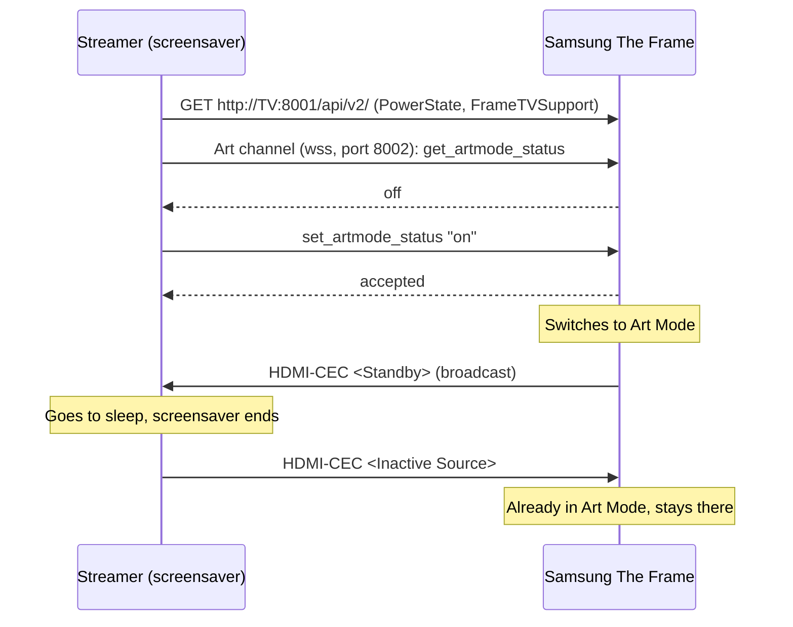

# Frame Art Mode: Samsung The Frame Art Mode screensaver for Google TV and Android TV

[](https://github.com/jkfran/frame-art-mode-screensaver/actions/workflows/build.yml)
[](https://github.com/jkfran/frame-art-mode-screensaver/releases/latest)
[](LICENSE)

**An Android TV and Google TV screensaver that switches a Samsung The Frame TV to Art Mode when the streamer goes idle, instead of letting the TV turn off or show "Check device power".**

It is made for the Google TV Streamer, Chromecast with Google TV, NVIDIA SHIELD TV and other Android TV devices. When Android starts the screensaver, the app asks The Frame over its local network API to switch to its real Art Mode. It is not a picture slideshow made to look like The Frame: it controls the TV. No cloud service, no account, no analytics.

- [Why](#why)
- [How it works](#how-it-works)
- [Requirements](#requirements)
- [Install](#install)
- [Set up](#set-up)
- [Settings](#settings)
- [Troubleshooting and FAQ](#troubleshooting-and-faq)
- [Compatibility](#compatibility)
- [Privacy and security](#privacy-and-security)
- [Building from source](#building-from-source)
- [Credits](#credits) · [Trademarks](#trademarks) · [License](#license)

## Why

The Frame goes to Art Mode by itself when the input it shows stops sending a picture. A source without HDMI-CEC, such as a computer that goes to sleep, gets Art Mode within a few seconds.

A streamer with HDMI-CEC never takes that path. When an Android TV or Google TV device goes to sleep while it is the TV's active source, Android tells the TV over HDMI-CEC, according to the device's `power_control_mode` setting:

| Streamer's `power_control_mode` | What the streamer sends | What The Frame does |
|---|---|---|
| `to_tv`, `to_tv_and_audio_system`, `broadcast` | `<Standby>` | Turns off. No Art Mode. |
| `none` | `<Inactive Source>` | Switches to the previous HDMI input. If the device on that input is off, the TV shows **"Check device power"**. |

Neither ends in Art Mode. Switching HDMI-CEC off avoids the message, but also gives up what CEC does: the TV remote no longer controls the streamer, and the streamer no longer turns the TV on or switches its input.

Frame Art Mode keeps HDMI-CEC on and asks the TV for Art Mode directly, before the streamer goes to sleep.

## How it works

1. When the streamer has been idle for the screensaver delay, Android starts the Frame Art Mode screensaver (a `DreamService`, the Android screensaver API once called Daydream). The screen stays black.
2. The app reads the TV's device information at `http://<tv>:8001/api/v2/`. It goes on only if the TV that answers is the one you chose, reports `PowerState` `on` and supports Art Mode (`FrameTVSupport` `true`). A TV that is off or in standby is never woken or switched.
3. It opens the TV's art channel (`com.samsung.art-app`, a WebSocket on port 8002) and reads the Art Mode status. If Art Mode is already on, it stops there.
4. It sends `set_artmode_status` `on`, once. The TV's reply, or its own `art_mode_changed` announcement if that comes first, confirms it; after a reply the app also reads the status back.
5. The Frame switches to Art Mode and broadcasts HDMI-CEC `<Standby>`, which every CEC device connected to the TV receives. The streamer goes to sleep. Because the TV asked for it, the streamer does not send `<Standby>` back. It still sends `<Inactive Source>`, which a TV in Art Mode ignores, so the TV stays in Art Mode.



In the screensaver, each attempt is limited to 20 seconds. A connection to the art channel that fails for a transient reason is retried twice, after 1 and 2 seconds; the Art Mode request itself is never sent twice. Every attempt is recorded in the app's Activity list. When something needs your attention, such as the Art Store terms (see below), the screensaver shows a message on its black screen and moves it to a new spot every minute.

The messages on the wire are described in [docs/PROTOCOL.md](docs/PROTOCOL.md).

## Requirements

- **A Samsung The Frame on the same local network as the streamer**, reachable over IPv4 on ports 8001 and 8002. A guest network or Wi-Fi client isolation between the two blocks it.
- **The Art Store terms accepted once on the TV.** Until they are, the TV refuses Art Mode requests (error `-2`) and shows Samsung's "Terms & Conditions, Privacy Notice & Device Features" screen. Only two items are needed: **Terms and Conditions for the Samsung Art Store** and **Art Store Privacy Notice**. The advertising and viewing-information consents are not needed.
- **HDMI-CEC on at both ends**: Anynet+ (HDMI-CEC) on the TV, and HDMI-CEC on the streamer. Without it the TV still switches to Art Mode, but cannot put the streamer to sleep.
- **An Android TV or Google TV device** running Android 5.0 or later.
- **On Google TV, ADB once.** Google TV's own settings only offer Google's Ambient mode, so a third-party screensaver is selected with ADB from a computer or another ADB client.

Recommended: give the TV a fixed address (a DHCP reservation in the router). The app stores the TV's IP address and does nothing when another device answers there.

## Install

1. Download `frame-art-mode-screensaver-<version>.apk` from the [latest release](https://github.com/jkfran/frame-art-mode-screensaver/releases/latest). Each release also carries a `.sha256` file to check the download:

   ```sh
   shasum -a 256 -c frame-art-mode-screensaver-<version>.apk.sha256
   ```

2. Install it with ADB (see [docs/GOOGLE_TV_SETUP.md](docs/GOOGLE_TV_SETUP.md) to turn on debugging and connect):

   ```sh
   adb connect <streamer-ip>
   adb install frame-art-mode-screensaver-<version>.apk
   ```

   Update later with `adb install -r` and the newer APK; settings are kept. Other sideloading methods work too, but Google TV needs ADB for the next step anyway.

Frame Art Mode then appears among the streamer's apps.

## Set up

### 1. Choose the TV

Open Frame Art Mode on the streamer, with the TV on.

- **Find TVs** asks every address of the streamer's local network for the Samsung TV API and lists the TVs that answer, with name, model, whether it is a Frame, and IP address. Choose your The Frame. Only TVs that report Art Mode support can be chosen.
- Or type the TV's IPv4 address and select **Use this address**.
- **Check TV** shows the TV's power state, Art Mode support, Art Mode status and art service version. It sends no Art Mode request.
- **Test now: switch to Art Mode** does what the screensaver does. As in normal use, the TV then puts the streamer to sleep; press Home on the streamer's remote to come back (twice when its HDMI-CEC `power_control_mode` is `none`, see the FAQ). If the TV asks whether to allow Frame Art Mode, choose Allow. If it shows the terms screen, see [the FAQ](#the-tv-shows-terms--conditions-or-the-activity-list-asks-for-the-art-store-terms-error--2).

### 2. Select Frame Art Mode as the screensaver

**Google TV** (Google TV Streamer, Chromecast with Google TV and other Google TV devices). Let the app change the screensaver setting itself, once, from a computer:

```sh
adb shell pm grant io.github.jkfran.frameartmode android.permission.WRITE_SECURE_SETTINGS
```

Then select **Set as screensaver** in the app, and **Screensaver delay** to choose how long the streamer waits (1 minute to 1 hour, shorter than the time after which the streamer goes to sleep). Without the grant, the app shows the exact commands instead. They are:

```sh
adb shell settings put secure screensaver_components io.github.jkfran.frameartmode/.ArtModeDreamService
adb shell settings put secure screensaver_enabled 1
adb shell settings put secure screensaver_activate_on_sleep 1
adb shell settings put system screen_off_timeout 600000   # 10 minutes, in milliseconds
```

[docs/GOOGLE_TV_SETUP.md](docs/GOOGLE_TV_SETUP.md) has the full walk-through: developer options, network debugging, checking the result and going back to Google's Ambient mode.

**Android TV** (for example NVIDIA SHIELD TV): Settings > Device Preferences > Screen saver > Screen saver > Frame Art Mode. "When to start" sets the delay and "Start now" tries it. **Open system settings** in the app opens that screen on devices that have it.

### 3. Try it

Set a short delay such as 1 minute, show the streamer on the TV and leave the remote alone. The TV switches to Art Mode and the streamer goes to sleep. The app's **Activity** list shows what happened. Then set the delay you want.

## Settings

| Setting | Default | What it does |
|---|---|---|
| **Find TVs**, **Use this address** | | Chooses the TV. The app stores its address, its ID and its Wi-Fi MAC address, and refuses to act when another TV answers at that address. |
| **Test now: switch to Art Mode** | | Runs one attempt now. It also clears a pending Art Store terms refusal (see the FAQ). |
| **Check TV** | | Reads the TV's state. Sends no Art Mode request. |
| **Set as screensaver** | | Selects Frame Art Mode as the system screensaver. Needs the ADB grant above; without it, shows the commands. |
| **Screensaver delay** | the device's | 1, 2, 5, 10, 15 or 30 minutes, or 1 hour of inactivity, as long as it is shorter than the time after which the device goes to sleep (its `sleep_timeout` and `attentive_timeout`, set in its energy settings); otherwise the screensaver never starts, and the app warns about it. Writes `screen_off_timeout`; needs the ADB grant, otherwise shows the command. |
| **Open system settings** | | Opens the system's screensaver settings, on devices that have such a screen. |
| **End the screensaver after Art Mode starts** | off; 10 seconds | Ends the screensaver 5 seconds to 2 minutes after Art Mode was requested. Normally not needed: the TV puts the streamer to sleep over HDMI-CEC. When the screensaver ends, the streamer may go to sleep by itself, and then sends `<Standby>` or `<Inactive Source>` as described in [Why](#why). |
| **Power-key fallback** | off | Sends one power-key press over the TV's remote-control channel when the art channel cannot be used. Read [the caveat](#should-i-turn-on-the-power-key-fallback) first. Needs **Allow remote control on the TV** once. |
| **Activity** | | The last 50 attempts: time, what started it (screensaver, test, check, pairing) and the result. **Clear activity** empties it. |

## Troubleshooting and FAQ

### The TV shows "Terms & Conditions", or the Activity list asks for the Art Store terms (error -2)

The Frame refuses Art Mode requests with error `-2` until the Samsung Art Store terms are accepted, and shows its "Terms & Conditions, Privacy Notice & Device Features" screen. Tick **Terms and Conditions for the Samsung Art Store** and **Art Store Privacy Notice**, then press OK. The other consents (advertising, viewing information) are not needed. Then select **Test now** in the app.

After this refusal the screensaver does not ask the TV again for 24 hours, so the TV does not keep showing the screen. **Test now** asks at once, and brings the TV's terms screen back if it was dismissed. The power-key fallback is never used for this error.

### After Art Mode, Home has to be pressed twice to get the picture back

This is how the streamer behaves when its HDMI-CEC `power_control_mode` is `none`, and the app is not running at that point. With `none`, Android sends no One Touch Play when the streamer wakes. When the streamer wakes while the TV is in Art Mode, Android asks the TV for its power status over HDMI-CEC. The TV reports that it is on, so the first key press does not take over the screen. A second press of Home sends One Touch Play and the TV switches to the streamer. Selecting the input with the TV's remote works too. With the other `power_control_mode` values, Android sends One Touch Play by itself when the streamer wakes.

### The TV switches to Art Mode, but the streamer stays awake

The TV puts the streamer to sleep over HDMI-CEC. Check:

- On the TV: **Anynet+ (HDMI-CEC)** is on. It is under Settings > General > External Device Manager, or Settings > Connection > External Device Manager on newer models.
- On the streamer: HDMI-CEC is on (on Google TV, usually under Settings > Display & Sound).

A streamer that stays awake goes to sleep by itself later, and then sends `<Standby>` (which turns The Frame off, also from Art Mode) or `<Inactive Source>`, depending on its `power_control_mode`. See [the HDMI-CEC notes](docs/GOOGLE_TV_SETUP.md#optional-hdmi-cec-settings-that-matter).

### The TV switched to Art Mode while another input was in use

The app cannot tell which input the TV is showing. If the streamer stays awake after the TV has switched to another input, its screensaver starts after the delay and switches the TV to Art Mode. Android 12 and later have an HDMI-CEC setting that puts the streamer to sleep when the TV switches away from it, `power_state_change_on_active_source_lost`. With `standby_now` this does not happen. See [the HDMI-CEC notes](docs/GOOGLE_TV_SETUP.md#optional-hdmi-cec-settings-that-matter).

### Nothing happens when the screensaver starts

Open the app and look at **Activity**:

- **"The TV is in standby, so nothing was sent"** or **"The TV did not answer"**: by design. The app never wakes a TV that is off.
- **"Another TV now answers at the chosen address"**: the TV's IP address changed. Choose the TV again, and give it a DHCP reservation.
- **No screensaver entry at all**: Frame Art Mode is not the screensaver, or the screensaver did not start. The app's Screensaver section says whether Frame Art Mode is the selected screensaver. A system update or a change in the Ambient mode settings can select Google's screensaver again; use **Set as screensaver** again. While a video plays, Android does not start any screensaver.

### The TV refused the connection, or asks to allow Frame Art Mode

When the TV asks whether to allow "Frame Art Mode", choose Allow. If it was denied, open External Device Manager > Device Connection Manager > Device List on the TV and allow Frame Art Mode, then use **Test now** (or **Allow remote control on the TV** for the fallback). When the TV refuses, the app forgets its stored token and does not retry.

### Should I turn on the power-key fallback?

Only if the art channel does not work on your TV. On The Frame, a short press of the power key normally toggles between TV mode and Art Mode, so the app sends at most one press per attempt, and only when all of these hold:

- the TV reports `PowerState` `on`, at the start and again right before the press;
- the art channel could not be used: no connection, or the TV rejected the request with an error other than `-2`. A TV that does not answer in time gets no press, since it may be going to standby or already showing art;
- the TV did not ask for its Art Store terms or refuse access, was not already in Art Mode, and no Art Mode request was sent that may have gone through;
- the TV has allowed Frame Art Mode on its remote-control channel (**Allow remote control on the TV**).

When the art channel cannot be reached, the app cannot see whether Art Mode is already on. If it is, the press switches the TV back to TV mode. That is why the fallback is off by default.

### Home Assistant says the TV is on while it shows art

The TV's `/api/v2/` endpoint reports `PowerState` `on` both in TV mode and in Art Mode; it reports `standby` only when the TV is off. Integrations that read that field, Home Assistant's among them, show The Frame as on while it shows art. Only the art channel tells the two apart. Frame Art Mode reads both before it sends anything, and **Check TV** shows both.

### Does Frame Art Mode turn the TV on?

No. It sends nothing to a TV that is off, in standby or not answering, and it never uses Wake-on-LAN.

### Can Google TV be set up without a computer?

Selecting a third-party screensaver on Google TV needs ADB once. Any ADB client works, including ADB apps for phones on the same network. Installing the APK can be done with any sideloading method.

## Compatibility

| Device | Status |
|---|---|
| Samsung The Frame (2024) with Google TV Streamer (Android 14) | Verified |
| Other Samsung The Frame models, and The Frame Pro, whose art channel accepts `set_artmode_status` | Expected to work |
| Chromecast with Google TV (4K and HD) | Expected to work |
| NVIDIA SHIELD TV | Expected to work |
| Other Android TV and Google TV devices, Android 5.0 or later | Expected to work |
| Amazon Fire TV | Untested. Fire OS is based on Android but has Amazon's own screensaver system, which may not start a third-party screensaver. |
| Apple TV, Roku and other devices that do not run Android | Not supported: the app cannot run on them. |
| Samsung TVs that do not report `FrameTVSupport` `true`, TVs of other brands | Not supported: the app does nothing. |

Results with other TVs and streamers are welcome as [issues](https://github.com/jkfran/frame-art-mode-screensaver/issues/new/choose), with the TV's model, year and firmware version and the streamer's model and Android version.

## Privacy and security

- The app talks only to the TV you choose, on your local network. **Find TVs** sends one request for `/api/v2/` to each address of the streamer's subnet (at most 254 addresses).
- It does not connect to the internet. There are no analytics, ads or accounts. The only outside link is **Open project page**, which opens this repository in a browser when you select it.
- The token the TV may issue is stored in the app's private storage, excluded from backups and device transfers, sent only over TLS and masked in logs and in the Activity list.
- The TV's self-signed certificate is accepted only for connections to the TV's own address; nothing is trusted globally. Device information is read over plain HTTP on port 8001, because that is how the TV serves it.
- Permissions: `INTERNET` (needed for any network connection, local ones included), `ACCESS_NETWORK_STATE` (to find the local network for **Find TVs**), and `WRITE_SECURE_SETTINGS`, which only an ADB grant gives and which is used only by **Set as screensaver** and **Screensaver delay**.

Security issues: see [SECURITY.md](SECURITY.md).

## Building from source

Requirements: JDK 17 or later (CI uses JDK 21) and the Android SDK with the API 37 platform. Point Gradle at the SDK with `sdk.dir` in `local.properties` or with `ANDROID_HOME`. The project uses the Gradle wrapper; nothing else needs installing.

```sh
./gradlew testDebugUnitTest   # JVM unit tests; no device, TV or network needed
./gradlew lintDebug           # Android lint; any error fails the build
./gradlew assembleDebug       # app/build/outputs/apk/debug/app-debug.apk
./gradlew assembleRelease     # minified with R8
```

`assembleRelease` signs the APK when these environment variables are set, and otherwise produces `app-release-unsigned.apk`:

| Variable | Value |
|---|---|
| `FRAME_KEYSTORE_FILE` | path to the keystore |
| `FRAME_KEYSTORE_PASSWORD` | keystore password |
| `FRAME_KEY_ALIAS` | key alias |
| `FRAME_KEY_PASSWORD` | key password |

CI builds, tests and lints every push and pull request. Pushing a tag `vX.Y.Z` builds the signed APK and publishes it as a GitHub release, with its notes taken from [CHANGELOG.md](CHANGELOG.md). See [CONTRIBUTING.md](CONTRIBUTING.md) before opening a pull request.

## Credits

The TV's WebSocket API and its art channel were documented by [samsung-tv-ws-api](https://github.com/xchwarze/samsung-tv-ws-api) (xchwarze) and the art API work in [NickWaterton/samsung-tv-ws-api](https://github.com/NickWaterton/samsung-tv-ws-api). Frame Art Mode is an independent Kotlin implementation and contains no code from those projects.

## Trademarks

Samsung, The Frame, Anynet+ and Samsung Art Store are trademarks of Samsung Electronics Co., Ltd. Android, Android TV, Google TV and Chromecast are trademarks of Google LLC. NVIDIA and SHIELD are trademarks of NVIDIA Corporation. Frame Art Mode is an independent project, not affiliated with, endorsed by or sponsored by any of them.

## License

[MIT](LICENSE) © 2026 Francisco Jimenez Cabrera
